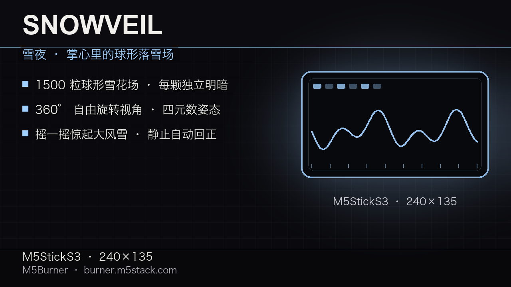

# Snowveil ❄️

A snow night you can hold in your palm — **M5StickS3** edition.
A pure black screen, a thousand snowflakes drifting through a sphere around your viewpoint.
Tilt the device to look anywhere; shake it and a blizzard bursts for ten seconds;
leave it still and the camera quietly rights itself so the snow falls straight down.

[中文文档 · Chinese README](README_CN.md)



## What you get

- **Spherical snow field** — 1,500 flakes spread in a sphere centred on the camera, so there is
  snow to see in *every* direction (no empty corners, no "wall").
- **Free 360° view** — the built-in IMU drives the viewpoint through pure quaternion gyro
  integration: no snap points, no rubber-band spring.
- **Depth × personality** — each flake carries its own brightness; depth falloff layered on top,
  so the picture has real layers.
- **Shake for a blizzard** — one shake triggers a 10-second storm: faster falling, deeper wind,
  then a slow settle.
- **Auto re-centering** — after 2 s of stillness the camera glides back to "snow falls down"
  (~7 s, imperceptible); any movement cancels it.
- **Two-button flow** — BtnA locks/unlocks the view, BtnB steps through 7 screen-brightness
  levels. No menus, nothing to configure.

## Controls

| Input | Action |
|------|------|
| Tilt / rotate the device | Free 360° view |
| **BtnA** | Lock / unlock the view (faint `LOCK` hint, bottom right) |
| **BtnB** | Screen brightness, 7 levels |
| Shake | Blizzard for 10 s |

## Install

### Easiest — M5Burner

Grab the merged image from the [Releases](https://github.com/andjiang0083/snowveil/releases)
page and flash it with [M5Burner](https://shop.m5stack.com/) or the
[web burner](https://burner.m5stack.com/) (device: **M5StickS3**).
See [releases/README_M5Burner.md](releases/README_M5Burner.md) for step-by-step.

### esptool

```bash
esptool.py --port /dev/cu.usbmodemXXXX write_flash 0x0 snowveil-vX.Y-merged.bin
```

The merged image is written at offset **0x0** (bootloader + partition table + app in one file).

## Develop

```bash
# needs PlatformIO:  pip install platformio
pio run -e sticks3 -t upload --upload-port /dev/cu.usbmodemXXXX
```

Single-file firmware: [`src/main.cpp`](src/main.cpp) (~470 lines — particles, quaternion
attitude, rendering, splash, all in one place on purpose). Dependencies are pinned to exact
versions in `platformio.ini` so a fresh clone builds the same firmware.
Details, release-asset layout and troubleshooting: [BUILDING.md](BUILDING.md).

## License

MIT — see [LICENSE](LICENSE).
